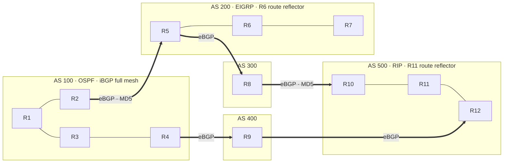

# BGP Multi-AS Lab (GNS3)

A 12-router lab built in GNS3 on Cisco 7200 routers. It connects five autonomous systems with eBGP, runs a different IGP inside each AS, and applies BGP security and path-selection controls.

## Topology

| Link | Subnet | Session |
|---|---|---|
| R1 – R2 | 10.1.1.0/24 | iBGP, AS 100 |
| R1 – R3 | 10.1.2.0/24 | iBGP, AS 100 |
| R3 – R4 | 10.1.3.0/24 | iBGP, AS 100 |
| R5 – R6 | 10.1.4.0/24 | iBGP, AS 200 (RR client) |
| R6 – R7 | 10.1.5.0/24 | iBGP, AS 200 (RR client) |
| R10 – R11 | 10.1.6.0/24 | iBGP, AS 500 (RR client) |
| R11 – R12 | 10.1.7.0/24 | iBGP, AS 500 (RR client) |
| R2 – R5 | 192.168.10.0/24 | eBGP 100–200, MD5 authentication |
| R4 – R9 | 192.168.11.0/24 | eBGP 100–400 |
| R5 – R8 | 192.168.12.0/24 | eBGP 200–300 |
| R8 – R10 | 192.168.14.0/24 | eBGP 300–500, MD5 authentication |
| R9 – R12 | 192.168.15.0/24 | eBGP 400–500 |

## What the lab covers

- **IGPs per AS:** OSPF in AS 100, EIGRP in AS 200, RIP in AS 500
- **iBGP:** full mesh in AS 100; route reflectors in AS 200 (R6) and AS 500 (R11)
- **eBGP** between all five autonomous systems, with `next-hop-self` on iBGP sessions
- **Authentication:** MD5 passwords on the R2–R5 and R8–R10 eBGP sessions
- **Path attributes:**
  - Weight on R4
  - Local Preference on R11
  - AS-Path prepending on R5 and R8
  - MED on R9

## Files

| File | Contents |
|---|---|
| `full BGP.gns3` | GNS3 project (open in GNS3 with a Cisco 7200 image) |
| `BGP.mp4` | Walkthrough video of the running lab |
| `BGP (1).pdf` | Lab task sheet |
| `New Microsoft Word Document.docx` | Lab checklist |

Router startup configs:

| Router | Config |
|---|---|
| R1 | [`i1_startup-config.cfg`](project-files/dynamips/9a566eef-39ca-43c5-a448-0e15007e7f68/configs/i1_startup-config.cfg) |
| R2 | [`i2_startup-config.cfg`](project-files/dynamips/f9a35fc2-6e51-42b4-bad7-c8085cea265d/configs/i2_startup-config.cfg) |
| R3 | [`i3_startup-config.cfg`](project-files/dynamips/05855f47-803d-4b91-9cad-fa86dba59e1b/configs/i3_startup-config.cfg) |
| R4 | [`i4_startup-config.cfg`](project-files/dynamips/5c21160c-4155-49e2-86f3-d33ad20ec4df/configs/i4_startup-config.cfg) |
| R5 | [`i5_startup-config.cfg`](project-files/dynamips/d15369a0-f96b-43b8-aa14-f0e778f2e855/configs/i5_startup-config.cfg) |
| R6 | [`i6_startup-config.cfg`](project-files/dynamips/052a3945-29e7-4686-bb22-068d429c1a9d/configs/i6_startup-config.cfg) |
| R7 | [`i7_startup-config.cfg`](project-files/dynamips/98735291-867b-457f-8725-c02e9e6b65a3/configs/i7_startup-config.cfg) |
| R8 | [`i8_startup-config.cfg`](project-files/dynamips/17d549c7-1ed3-4192-8ebf-b0d85b6d2d7f/configs/i8_startup-config.cfg) |
| R9 | [`i9_startup-config.cfg`](project-files/dynamips/d70f597e-404c-4a50-944f-0428661ecce6/configs/i9_startup-config.cfg) |
| R10 | [`i10_startup-config.cfg`](project-files/dynamips/a7607dad-a6e9-4204-b9ff-79e5089fcc09/configs/i10_startup-config.cfg) |
| R11 | [`i12_startup-config.cfg`](project-files/dynamips/98d1caa2-9aba-4529-a4f4-5f57d86af28e/configs/i12_startup-config.cfg) |
| R12 | [`i11_startup-config.cfg`](project-files/dynamips/84c75409-29d7-4548-a830-22922b1e2baf/configs/i11_startup-config.cfg) |

> Lab environment only. Addresses and passwords are lab values.

Lab write-up on LinkedIn: [BGP lab post](https://www.linkedin.com/feed/update/urn:li:activity:7329400297468985344/)

Thanks to Eng. Ahmed Abdalla and Eng. Mohamed El Hady.
